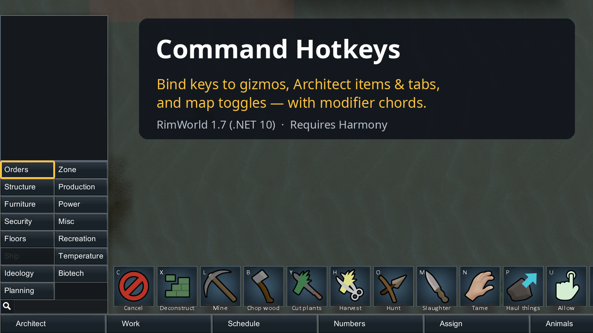

# Command Hotkeys



A RimWorld 1.7 (.NET 10) mod that binds keys to command buttons (gizmos), Architect items, Architect category tabs (working even while the menu is closed), and the map-screen toggle icons — with modifier chord support (`LCtrl+F1`, `LShift+...`, `LAlt+...`, etc.).

An independent spiritual successor to [Hotkeys 1.6](https://steamcommunity.com/sharedfiles/filedetails/?id=3536306259) and [Architect Hotkeys Anywhere](https://steamcommunity.com/sharedfiles/filedetails/?id=3824191022), written from scratch with no code from the original Hotkeys mod.

## Features

- **Command buttons (gizmos) & Architect items**: hover over a command button or select an Architect item, press the assign key (default `\`), choose **Set key**, and press any key or chord. Key letters appear on command buttons.
- **Architect category tabs**: bind keys under *Options → Keyboard → Command hotkeys: Architect*. Pressing a category key opens the Architect menu directly on that tab (and pressing it again closes the menu).
- **Map toggles**: bind keys for the bottom-right icons (zones, roof / fertility / terrain / temperature / pollution / vacuum overlays, colonist bar, learning helper, auto home area, auto rebuild, categorized resource readout) under *Options → Keyboard → Command hotkeys: map toggles*.
- **Modifier chords**: supports `Ctrl` / `Shift` / `Alt` (left and right distinguished) for this mod's bindings. *Options → Keyboard* shows and sets chords directly.
- **Import from Hotkeys**: mod settings include an importer to copy existing Architect category and item bindings (including chords) from the older Hotkeys mod.

## Get it

- Steam Workshop: https://steamcommunity.com/sharedfiles/filedetails/?id=3840240333

## Requirements

- [Harmony](https://steamcommunity.com/sharedfiles/filedetails/?id=2009463077) (`brrainz.harmony`) — used only to patch `Dialog_KeyBindings.DrawKeyEntry` so modifier chords display and bind in *Options → Keyboard*.
- RimWorld 1.7 (.NET 10).
- **Do not use together with Hotkeys or Architect Hotkeys Anywhere** — disable them before enabling this mod to avoid duplicate key handling (you can still import your old Hotkeys bindings from mod settings).

## Install / Build

Copy `About/`, `Assemblies/`, `Defs/`, and `Languages/` into `RimWorld/Mods/CommandHotkeys/`.
The included DLL is the 1.7 (.NET 10) build.

To build from source, you need the .NET 10 SDK, a RimWorld 1.7 install, and Harmony's `0Harmony.dll`:

```bash
tools/deploy.sh /path/to/RimWorld   # builds Source/ and copies loadable files into Mods/CommandHotkeys
```

You can override the Harmony DLL path with `-p:HarmonyDll=/path/to/0Harmony.dll`.

## License

MIT — see [LICENSE](LICENSE).
